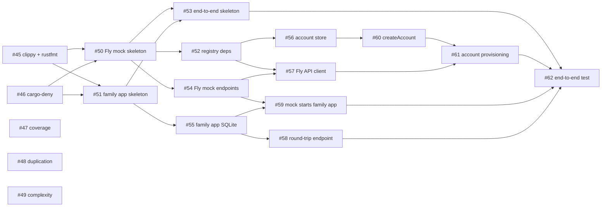

# Family AI — First Build: PR Sequence

*Last updated 25 October 2026.*

Breaks the account-to-VM skeleton spec into an ordered sequence of PRs for agentic development, with tooling and testing built in from the start rather than bolted on.

## PR 0 — Foundation

Single dev container (not separate per-service containers) holding the full toolchain: Rust plus whatever the registry app's stack needs, all able to run and talk to each other over localhost. No attempt to mimic production's separate Firecracker isolation here — this is purely for a fast agentic dev loop.

Also in PR 0:

- Claude agent harness basics (AGENTS.md or equivalent, repo conventions).
- Written conventions and baseline principles for Claude to follow through the rest of the build.
- A pre-commit hook that **blocks the commit outright on failure**, scoped to **changed files only** (lint, tests, duplication/complexity checks on what changed). CI runs the full suite separately as the real gate before merge — the hook is a fast local check, not a substitute for CI.

**Working principles captured here** (apply throughout the build, not just PR 0):

- Every PR starts from a short written spec or checklist Claude confirms it understands before touching code.
- Decide per PR whether it needs a close human read or a skim, and size the PR accordingly (see working notes below).
- Claude runs tests itself and shows they pass before marking a PR done — the pre-commit hook backs this up automatically rather than relying on memory.
- Keep PRs small enough that Rust's slow compile times don't turn the test-fix-retest loop painful for the agent.

**Public repo hygiene** (the repo is public from the first commit, so history is public too):

- Make the AGPL-3.0 `LICENSE` file part of the first commit.
- Secret scanning in the pre-commit hook (gitleaks or similar), plus GitHub secret scanning with push protection switched on.
- No real Fly token or API key in GitHub Actions. CI runs against the Fly mock, so it never needs one.
- Fork PRs: CI workflows must not run untrusted code with secrets available.
- Dependabot (`.github/dependabot.yml`) and CodeQL (GitHub default setup). The repo settings and the free-for-public-repos evidence are in `docs/github-settings.md`.
- Decide which project docs get committed. Architecture docs are fine if you are happy sharing them; keep pricing and positioning out of the repo (the rule is in [docs/conventions.md](docs/conventions.md#what-goes-in-the-repo)).

## PR sequence

| # | PR | Notes |
| --- | --- | --- |
| 1 | Scaffold the registry app | Done (merged). Empty GraphQL schema, deployable. No logic yet. |
| 2 | Registry app tooling | Linting, duplication detection, complexity detection, coverage reporting, a dependency license check against the AGPL-compatible allowlist, wired into CI. Likely splits into separate PRs per tool — size each by how much judgement it needs from Gman. |
| 3 | Account creation mutation | Minimal — email or family name, stored in the registry's own metadata store. No Fly integration yet. |
| 4 | Fly mock service | Imitates the create-app, create-volume, create-Machine endpoints. Actually boots the real family Rust app as its "Machine" and hands back its address. No Firecracker — API shape only. Likely splits into the mock API shell first, then wiring it to actually spawn the family app. |
| 5 | Fly integration on the registry | Account creation calls the mock's API to create the family's app, volume and Machine. Swapping the mock for real Fly later shouldn't change this code, only the base URL. |
| 6 | Scaffold the Rust family app | Boots, connects to SQLite on its volume, runs migrations, creates the table. |
| 7 | Family app tooling | Folded into PR 2. The tooling is workspace-wide, so the family app is covered when it joins the workspace. |
| 8 | Round-trip endpoint | Write a row, read it back — real proof of the database round trip, not a hello-world reply. |
| 9 | End-to-end test suite | Registry + mock + family app together, asserting the full chain end to end. |
| 10 | Front end: form and waiting state | Account creation form, waiting state while the Machine boots. |
| 11 | Front end: direct handoff | Once ready, talks directly to the family app's address (not proxied through the registry) and shows the real response. |
| 12 | Persistence re-check | After an idle period (an hour or more), re-run the registry flow and confirm the earlier row is still on the volume. |

**PR 12 addition — boot timing.** Record cold boot time end to end (app create → volume attach → Machine start → app ready) and Rust family app startup time as logged metrics during the persistence check, rather than a tight blocking gate. The architecture notes (not in this repo) flag this as genuinely unmeasured — Firecracker itself boots in roughly 125 milliseconds, but the rest of the path (disk attach, mount, app start, migrations) has no real numbers yet. Assert only a generous sanity ceiling in CI for now (e.g. under 5 seconds, not 500 milliseconds) so a real regression still fails the build without chasing CI noise. Once real numbers exist, tighten the threshold with data instead of a guess.

Real Fly credentials swap in after this list, as a later step — not part of the twelve.

## Factory backlog for PRs 2–9

PRs 2–9 are queued on the factory board as issues #45–#62. Each spec opens with a Goal; if its details go stale, the Goal governs. `/factory next` takes the top unblocked issue, so several sessions can run in parallel.

**Decisions:**

- Tooling is workspace-wide and set up once. PR 7 is folded into PR 2.
- clippy + rustfmt and `cargo-deny` are strict gates and block feature work. Coverage, duplication and complexity fail only past generous thresholds and run alongside feature work. Tighten them later with real data.
- Plumbing is split from logic. Crate skeletons, dependency additions and CI wiring land in small PRs a human skims and merges. Each crate skeleton also widens the factory's allowed paths for that crate's `src/`, `tests/` and README, so follow-up jobs stay inside them.
- API contracts and data handling stay in small PRs that get a close human read. The approver escalates them.
- One SQLite stack for the workspace: `sqlx`, with migrations as `.sql` files under each app's `migrations/`.
- Accounts take an email and a family name. The email is unique, ignoring letter case. Keycloak is the planned identity provider and comes later; the account store is shaped so its subject id can take over the identity. Until auth exists, the polling query `accountStatus` returns only status and address, never personal data.
- The end-to-end suite runs on every PR as part of the required `ci` check.
- The front end (PRs 10–11) and PR 12 are planned once the front-end stack is chosen.

| Issue | Job | From PR | Blocked by | Review |
| --- | --- | --- | --- | --- |
| #45 | clippy + rustfmt gate | PR 2 | — | skim |
| #46 | cargo-deny gate | PR 2 | — | skim |
| #47 | coverage gate | PR 2 | — | skim |
| #48 | duplication gate | PR 2 | — | skim |
| #49 | complexity gate | PR 2 | — | skim |
| #50 | Fly mock crate skeleton | PR 4 | #45, #46 | skim |
| #51 | family app crate skeleton | PR 6 | #45, #46 | skim |
| #52 | registry dependencies | PRs 3, 5 | #50 | skim |
| #53 | end-to-end crate skeleton | PR 9 | #50, #51 | skim |
| #54 | Fly mock: create app, volume, Machine | PR 4 | #50 | close read |
| #55 | family app: SQLite on its volume | PR 6 | #51 | close read |
| #56 | registry: account store | PR 3 | #52 | close read |
| #57 | registry: Fly API client | PR 5 | #52, #54 | skim |
| #58 | family app: round-trip endpoint | PR 8 | #55 | close read |
| #59 | Fly mock starts the family app | PR 4 | #54, #55 | close read |
| #60 | registry: createAccount mutation | PR 3 | #56 | close read |
| #61 | registry: account provisioning | PR 5 | #60, #57 | close read |
| #62 | end-to-end: account to round trip | PR 9 | #53, #61, #59, #58 | skim |

The same dependencies as a graph. An arrow points from a job to the job it blocks.

Real Fly needs a later job that waits for a Machine to start, since real Fly returns `created` from create-Machine.

## Working notes: sizing and splitting PRs

Before starting any PR flagged above as a likely bundle, pause and break it down live rather than pre-deciding the exact cut up front.

Size each resulting PR by how much of Gman's attention it actually needs, not by a fixed line count:

- Boilerplate-heavy, low-judgement work (scaffolding, generated tooling config) can run bigger — it's skimmed, not read closely.
- Anything with real judgement calls — API contracts, data handling, security-adjacent code — stays small enough to read closely, line by line.

This rule applies as a standing step throughout the build, not just at the two flagged bundles (PR 2 and PR 4).

## Licensing

**Leaning towards AGPL-3.0, not yet final.** It is genuinely open source, and its network clause means anyone modifying it and running it as a service must offer their users the source. It does not stop a competitor running an unmodified public clone. O'Saasy and FSL were considered and set aside for now: both are source-available rather than open source, and both are less established.

**Dependency license gate.** An agent will add whatever dependency makes the tests pass without considering its license, so the check is mechanical rather than remembered:

- Permissive licenses (MIT, Apache-2.0, BSD, ISC, public domain such as SQLite) are fine.
- Disallow GPL-2.0-only, proprietary libraries, and source-available licenses with usage restrictions (SSPL, BSL, Elastic, FSL, O'Saasy).
- `cargo-deny` with a license allowlist covers every crate in the workspace, in CI and in the pre-commit hook when dependencies change. Added in PR 2 (#46).
- Dev tooling (linters, coverage, CI) is not linked into shipped code, so it is out of scope for the gate.

**Also decided to track:**

- A `LICENSE` file goes into the repo in PR 0 once the license is confirmed.

**Open questions:**

- Whether to require a CLA (or similar) before accepting outside contributions. Without one, the copyright holder cannot easily relicense or dual-license later, and App Store distribution of the native clients gets harder.
- Third-party license check for the front end's dependencies, once its stack is chosen.
